# 【PRD】权限中心

## 变更记录

| 时间 | 变更人 | 变更内容 |
|------|--------|----------|
| 2026-07-07 | 陈思思 | 新建 |

---

## 一、背景

### 1.1 现状痛点

- HR 域权限申请走 BPM 手动流转，没有与资源管理中心打通，人工配置效率低
- 权限没有有效期概念，存在大量「无效权限」长期留存
- 无法快速清查某人/某表的权限状态
- 权限审批节点固定，不能根据申请内容（涉及领域、组织范围、敏感等级）动态调整审批人

### 1.2 改造目标

在现有「资源管理中心」内建设「权限中心」模块，实现数据权限从 **申请 → 审批 → 生效 → 续签 → 归还/到期失效** 的全生命周期自动化管理，并通过动态审批流让正确的审批人审批正确的申请，减少冗余审批节点。

---

## 二、核心概念

| 名词 | 是什么 | 作用 |
|------|--------|------|
| 权限中心 | 资源管理中心内的独立模块 | 承载权限申请、审批、我的权限、生命周期管理的统一入口 |
| 列权限规则（角色） | 若干权限点跨表组合的字段圈选规则 | 作为「按角色申请」的预设模板，复用同一套字段授权范围 |
| 敏感等级 | 角色的安全分级（基础/敏感/高敏/极高敏） | 决定审批链路长度与是否需要加签 |
| 行权限 | 对数据行的过滤条件（组织、族、员工类型等） | 限定可访问的数据范围 |
| 有效期 | 权限的生效时间段 | 避免无效权限长期留存，支持自动失效 |
| 动态审批流 | 根据申请内容自动确定的审批链路 | 让正确的审批人审批正确的申请，减少冗余节点 |
| BPM | 快手内部审批流程中心 | 实际审批操作的位置，权限中心仅展示详情与跳转 |

---

## 三、角色定义

| 角色 | 描述 | 在系统中的视图 |
|------|------|----------------|
| 申请人 | 需要获取数据访问权限的员工（如 ODBP、CBBP、HRBP 等） | 申请权限、我的申请、我的权限 |
| 审批人 | 根据申请内容动态确定的审批节点（领域负责人、组织 BPH、人力线负责人等） | 在权限中心查看申请详情，实际审批在 BPM 流程中心完成 |

> ⚠️ 系统根据登录身份自动展示对应视图，不需要手动切换。审批人不需要在权限中心内执行审批操作，所有审批动作在 BPM 流程中心完成。

---

## 四、入口设计

权限中心作为独立模块，在资源管理中心左侧导航栏增加固定入口按钮「权限中心」，位于目录树下方、用户信息区上方。

点击后，右侧主内容区**完全切换**到权限中心，不依赖左侧目录树的任何选中状态。

权限中心内部包含三个核心 Tab：

- **我的申请**：查看本人提交的权限申请记录与审批进度
- **我的权限**：查看本人当前生效与历史权限，支持续签/归还/重新申请
- **我的审批**：审批人查看待本人审批的申请详情，跳转 BPM 完成审批

---

## 五、用户故事线

### 故事 1：申请人按标准角色申请权限

**场景**：一名新入职的 HRBP 需要访问员工基础数据，资源中心里有预定义的「OD-基础」列权限规则，对应若干表的若干字段。

**操作步骤**：

1. 进入「权限中心」→「我的申请」→ 点击「申请权限」
2. **选择业务域 + 申请方式**（Step1，合为一页）：

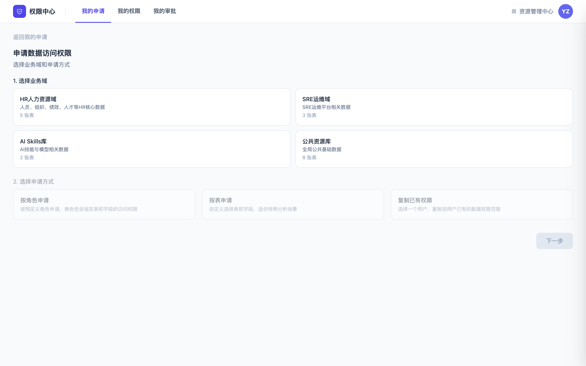

   - 选择业务域（HR 人力资源域、SRE 运维域、AI Skills 库、公共资源库等）
   - 选择申请方式：按角色申请 / 按表申请 / 复制已有权限

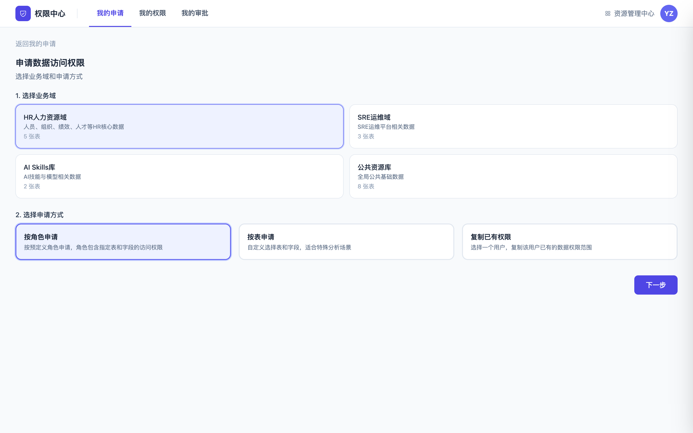

3. **选择角色**（Step2）：

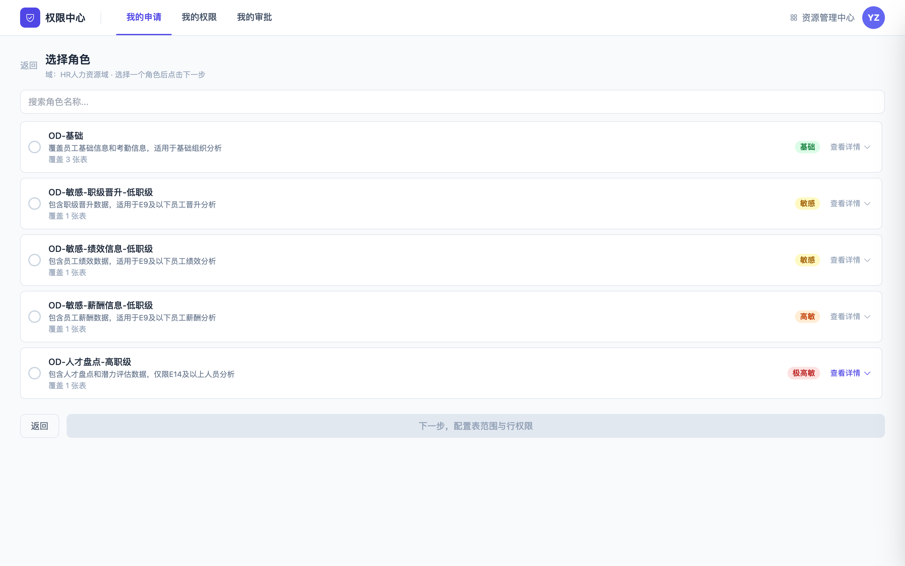

   - 展示该域下所有已定义的「列权限规则」清单
   - 每条规则显示名称、描述、敏感等级标签、覆盖表数
   - 支持按名称搜索
   - 支持展开查看角色覆盖的表与字段（按分类聚合展示，每分类最多 20 个字段）
   - 单选一条角色

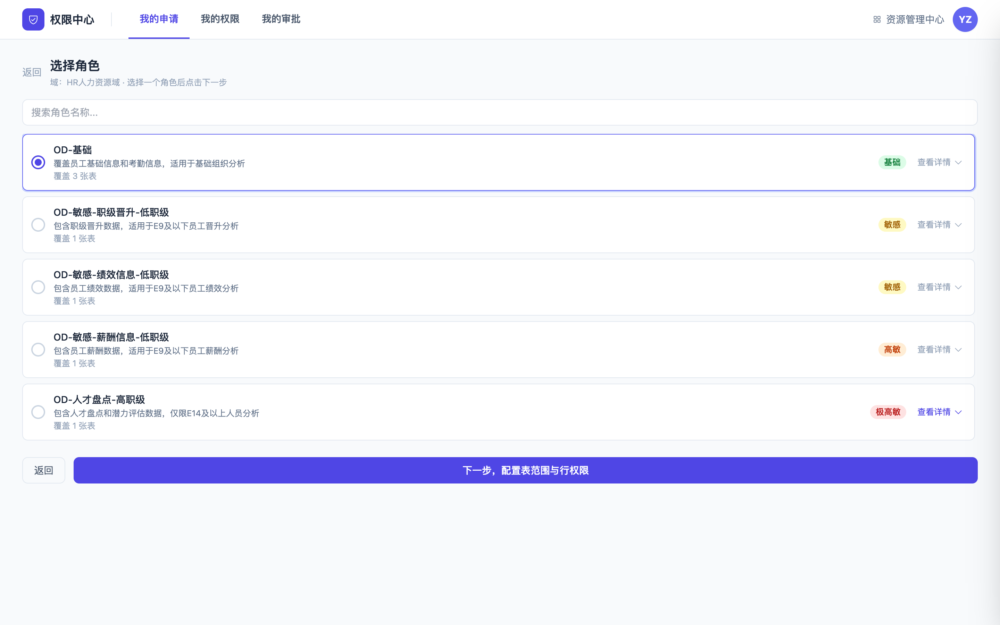

4. **配置表范围与行权限**（Step3）：

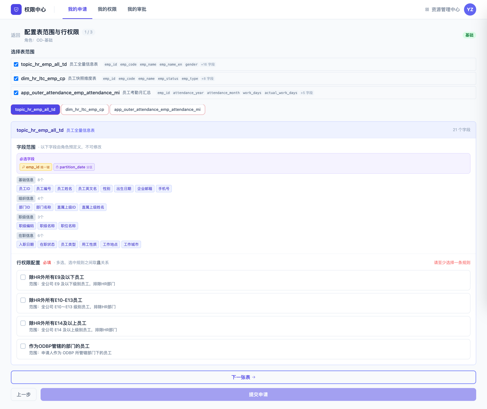

   - 勾选角色覆盖的表（可全选或部分勾选）
   - 逐表配置行权限（标签导航切换，必填，多选取「且」关系）
   - 字段范围由角色预定义，只读不可修改（必选字段如分区字段、唯一键字段自动包含）
5. **选择有效期**：7天 / 30天 / 90天 / 180天 / 365天（单选，固定选项）
6. **填写申请理由**：文本框，非必填
7. **提交申请**：系统调用 BPM 接口发起审批流，返回申请单号，通过 KIM 通知第一个审批节点的审批人

**结果**：

- 申请人在「我的申请」中可以看到申请状态和审批进度
- 审批全部通过后，权限自动生效，出现在「我的权限」中

### 故事 2：申请人按表自定义申请权限

**场景**：一名员工有特定的分析需求，现有的标准角色不完全匹配，需要自行选择表和字段。

**操作步骤**：

1. 进入「权限中心」→「我的申请」→ 点击「申请权限」→ 选择「按表申请」
2. **选择业务域**（Step1）

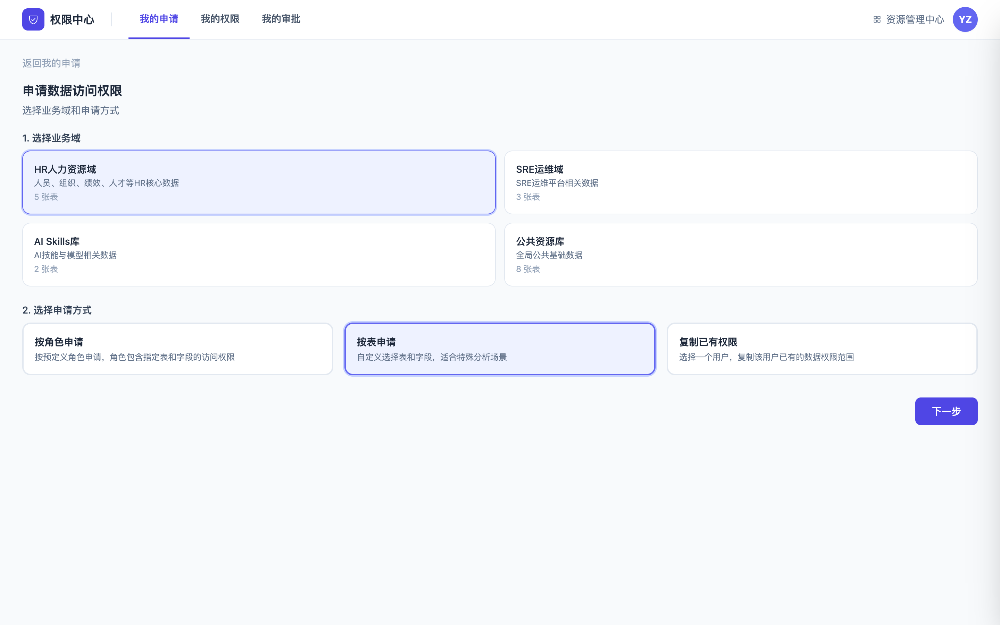

3. **选择数据表**（Step2）：

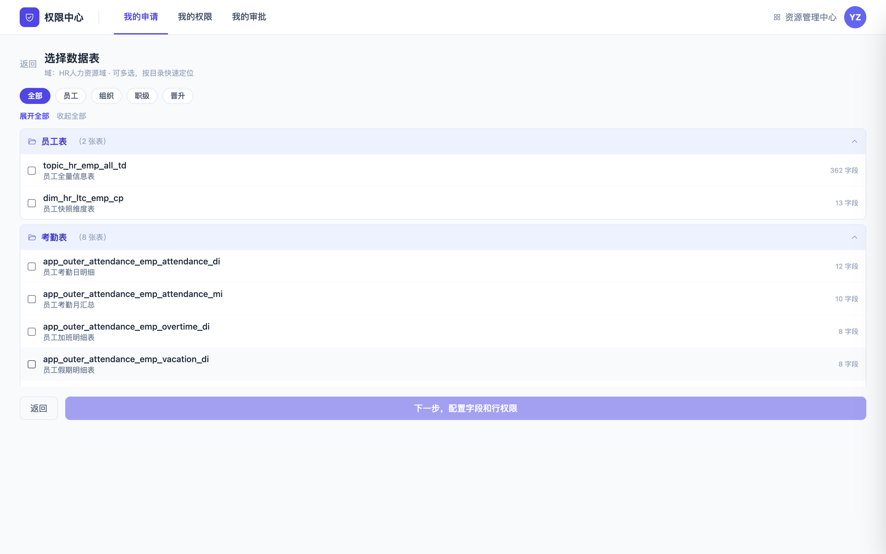

   - 按目录（文件夹）分组展示该域下的所有表
   - 支持分类快速过滤（员工/组织/职级/晋升等）
   - 支持展开/收起全部目录
   - 可多选任意数据表
4. **逐表配置字段与行权限**（Step3）：
   - 表标签导航切换
   - **列权限**：按分类展示字段，支持搜索、全选、按分类全选；分区字段必选且禁用、唯一键字段标识
   - **行权限**：结构化条件配置（所在组织、族、员工类型、员工性质、合同主体），支持「且/或」关系
5. **选择有效期 + 填写申请理由**（最后一张表时显示）
6. **提交申请**：系统根据所选字段中最高敏感等级自动推导对应审批链路，发起 BPM 审批

**结果**：同故事 1

### 故事 3：申请人复制已有权限

**场景**：一名员工需要与某同事相同的权限范围，希望快速复制以减少配置成本。

**操作步骤**：

1. 进入「权限中心」→「我的申请」→ 点击「申请权限」→ 选择「复制已有权限」
2. **选择业务域**（Step1）

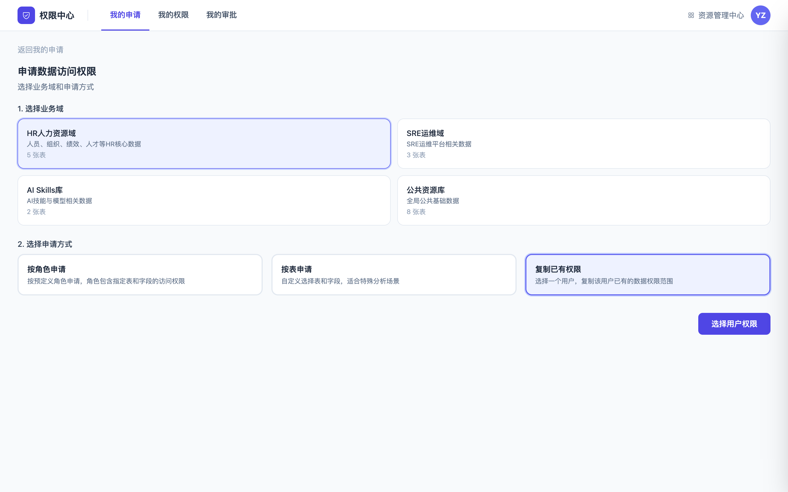

3. **选择用户与权限**（Step2）：

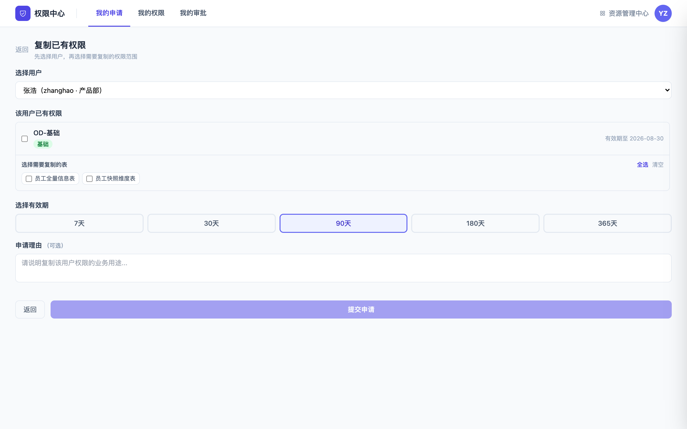

   - 选择要复制权限的用户（从可复制用户列表中选择）
   - 展示该用户已有的所有权限（按角色分组，显示敏感等级、有效期）
   - 勾选要复制的角色（支持全选/清空）
   - 在每个角色下勾选要复制的表（支持全选/清空）
4. **选择有效期 + 填写申请理由**
5. **提交申请**：系统发起 BPM 审批，审批流根据所复制权限的敏感等级和涉及领域动态确定

**结果**：同故事 1

### 故事 4：审批人处理审批

**场景**：审批人收到 KIM 消息，提示有权限申请需要他审批。

**操作流程**：

1. 审批人在 KIM 收到消息，点击跳转到 **BPM 流程中心**完成审批（通过/驳回/退回）
2. 审批人也可以登录权限中心，在「我的审批」中查看申请详情（包含申请的角色/字段/行规则/申请理由），但**不在权限中心内操作审批**
3. 审批完成后，申请人收到结果通知（通过 BPM/KIM）

### 故事 5：申请人查看申请进度

**场景**：提交申请后，申请人想知道现在走到第几个审批节点了。

**功能**：「我的申请」列表

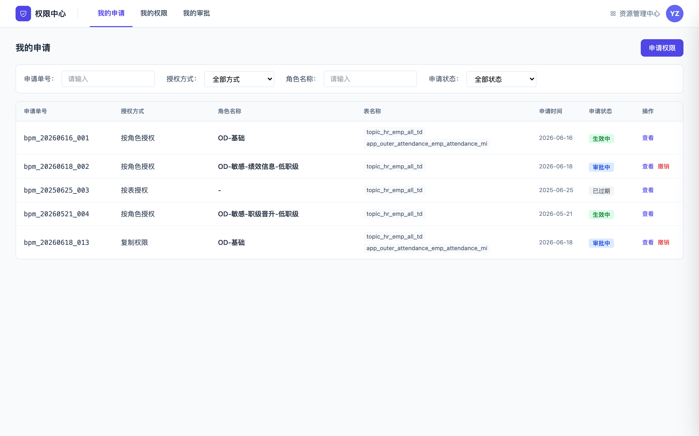

- 显示所有历史申请（包含待审批/审批中/已通过/已驳回/已撤销）
- 每条申请展示：申请单号、授权方式、角色名称、表名称、申请时间、申请状态
- 支持筛选：申请单号、授权方式、角色名称、申请状态
- 点击表格行打开**右侧详情抽屉**，查看基本信息、角色信息、表与权限详情、有效期、申请理由、审批流程节点链路
- 仅「待审批」状态的申请可以撤销

### 故事 6：申请人查看和管理自己的权限

**场景**：员工想知道自己现在有哪些数据权限，或者想主动放弃某个不再需要的权限。

**功能**：「我的权限」列表

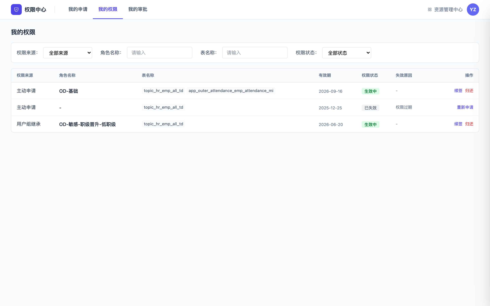

- 展示所有权限记录（生效中、已失效、主动归还）
- 每条记录展示：权限来源（主动申请/用户组继承）、角色名称、表名称、有效期、权限状态、失效原因
- 支持筛选：权限来源、角色名称、表名称、权限状态
- 点击表格行打开**右侧详情抽屉**，查看完整权限详情与审批流程

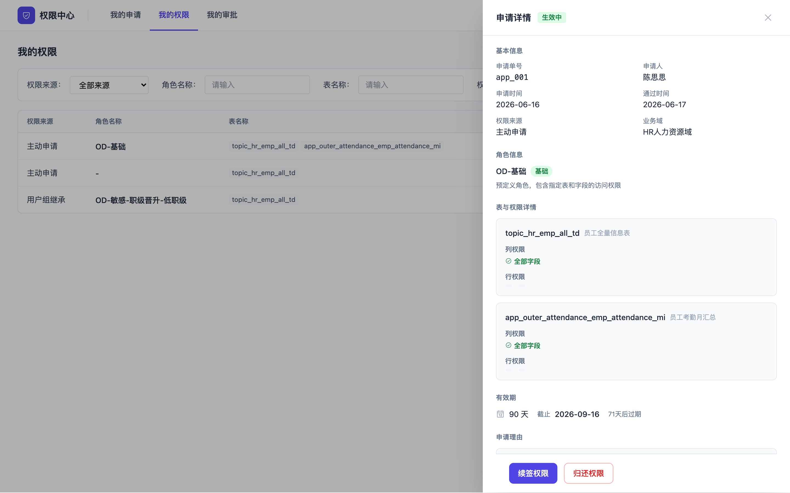

- 操作：
  - **续签**（生效中权限）：字段范围和行规则只读不可修改，仅更新有效期，触发审批流
  - **归还**（生效中权限）：二次确认弹窗，确认后立即失效
  - **重新申请**（已失效/已归还权限）：预填原申请信息，可编辑后重新提交

### 故事 7：系统自动提醒权限即将到期

**场景**：一个员工的权限在 5 天后到期，他之前没有主动关注。

**功能**：

- 系统在到期前 **7天、3天、当天** 各自动发送一条 KIM 消息
- 消息内容：告知哪个权限即将到期、到期时间、跳转到权限中心续签的链接
- 未在到期前完成续签审批：权限到期后自动失效

### 故事 8：员工离职，权限自动失效

**场景**：一名员工提交了离职申请，HR 系统在处理离职时触发权限回收。

**功能**：

- coreHR 在员工离职时通过接口推送消息到权限中心
- 权限中心自动将该员工的**所有生效权限立即失效**

---

## 六、需求详情

### 6.1 系统入口与视图

| 项 | 说明 |
|----|------|
| 入口位置 | 左侧导航栏固定按钮「权限中心」，位于目录树下方、用户信息区上方 |
| 视图切换 | 点击后右侧主内容区完全切换，不依赖左侧目录树选中状态 |
| Tab 结构 | 我的申请、我的权限、我的审批 |
| 角色自动识别 | 根据登录身份自动展示对应视图，不需要手动切换 |

### 6.2 权限申请

#### 6.2.1 申请流程总览

申请流程采用三步向导：

| Step | 按角色申请 | 按表申请 | 复制已有权限 |
|------|------------|----------|--------------|
| Step1 | 选域 + 选「按角色申请」 | 选域 + 选「按表申请」 | 选域 + 选「复制已有权限」 |
| Step2 | 选角色（带搜索、敏感等级、展开详情） | 选数据表（按目录分组、分类过滤） | 选用户 + 勾选要复制的角色与表 |
| Step3 | 逐表配置行权限（必填）+ 有效期 + 理由 | 逐表配置列权限+行权限 + 有效期 + 理由 | 有效期 + 理由 |

#### 6.2.2 按标准角色申请

**Step2 选角色**：

| 元素 | 说明 |
|------|------|
| 角色列表 | 展示该域下所有已定义的列权限规则，每条显示名称、描述、敏感等级标签、覆盖表数 |
| 搜索 | 支持按角色名称模糊搜索 |
| 展开详情 | 支持展开查看角色覆盖的表与字段，字段按分类聚合展示，每分类最多 20 个 |
| 选中方式 | 单选（radio），一次只能选一个角色 |

**Step3 配置表范围与行权限**：

| 元素 | 说明 |
|------|------|
| 表范围选择 | 勾选角色覆盖的表，可全选或部分勾选 |
| 字段范围 | 由角色预定义，只读不可修改；必选字段（分区字段、唯一键字段）自动包含 |
| 行权限配置 | 必填，从预定义规则库勾选（多选，条件间取「且」关系） |
| 表标签导航 | 逐表切换配置，当前表未配置行权限时标签高亮提醒 |
| 有效期 | 7/30/90/180/365 天单选 |
| 申请理由 | 文本框，非必填 |

#### 6.2.3 按表自定义申请

**Step2 选数据表**：

| 元素 | 说明 |
|------|------|
| 目录分组 | 按目录（文件夹）分组展示表，支持展开/收起 |
| 分类过滤 | 支持按员工/组织/职级/晋升等分类快速过滤 |
| 表选择 | 可多选任意数据表 |

**Step3 配置字段与行权限**：

| 元素 | 说明 |
|------|------|
| 表标签导航 | 逐表切换配置 |
| 列权限 | 按分类展示字段，支持搜索、全选、按分类全选；分区字段必选且禁用、唯一键字段标识 |
| 行权限 | 结构化条件配置（所在组织、族、员工类型、员工性质、合同主体），条件间支持「且/或」关系 |
| 有效期 | 7/30/90/180/365 天单选 |
| 申请理由 | 文本框，非必填 |
| 审批流推导 | 系统根据所选字段中最高敏感等级自动推导对应审批链路 |

#### 6.2.4 复制已有权限申请

| 元素 | 说明 |
|------|------|
| 用户选择 | 从可复制用户列表中选择（下拉） |
| 权限展示 | 展示该用户已有的所有权限，按角色分组，显示敏感等级、有效期 |
| 角色勾选 | 支持角色级勾选（勾选角色即默认全选该角色下的所有表） |
| 表勾选 | 每个角色下可单独勾选要复制的表（支持全选/清空） |
| 有效期 | 7/30/90/180/365 天单选 |
| 申请理由 | 文本框，非必填 |

#### 6.2.5 行权限配置

**按角色申请的行权限**：

- 从预定义规则库中勾选规则（如「除HR外所有E9及以下员工」、「作为ODBP管辖的部门的员工」等）
- 多选，选中规则之间取「且」关系
- 必填，每张表至少选择一条规则

**按表申请的行权限**：

- 结构化条件配置：
  - 所在组织（搜索多选，单条件内取并集）
  - 族（技术族/产品族/运营族/职能族/创意族/商业化族，多选）
  - 员工类型（正式员工/实习生/外包/劳务派遣/顾问，多选）
  - 员工性质（全职/兼职/返聘/HRO/BOT，多选）
  - 合同主体（文本输入）
- 多个条件之间支持「且/或」关系选择

#### 6.2.6 有效期

| 选项 | 说明 |
|------|------|
| 7天 | 适用于短期临时分析 |
| 30天 | 适用于月度分析任务 |
| 90天 | 适用于季度分析任务 |
| 180天 | 适用于半年期项目 |
| 365天 | 适用于长期稳定需求 |

> 有效期为固定选项，不支持自定义。续签时同样从这 5 个选项中选择新的有效期。

#### 6.2.7 提交与状态查询

| 项 | 说明 |
|----|------|
| 提交动作 | 调用 BPM 接口发起审批流，返回申请单号 |
| 通知 | 通过 KIM 消息通知第一个审批节点的审批人 |
| 提交成功页 | 展示申请单号、提示审批人将通过 KIM 收到通知，提供「查看我的申请」与「再次申请」两个入口 |
| 状态查询 | 在「我的申请」中查看申请状态和审批进度 |

#### 6.2.8 重复申请处理（追加/覆盖）

允许用户在已有待审批申请或已有生效权限时，重复发起新的权限申请。为避免权限范围冲突，申请时需标注本次申请与已有权限的关系：

| 标注类型 | 说明 | 适用场景 |
|----------|------|----------|
| 追加权限 | 新申请的权限范围与已有权限并存，生效后原有权限保留，新增申请的表/字段/行范围叠加生效 | 需要扩展数据访问范围（如新增表、新增字段、新增行范围） |
| 覆盖已有权限 | 新申请的权限生效后，原有同表同字段的权限被覆盖（失效），以新申请的行权限为准 | 需要调整行权限范围（如从「E9及以下」改为「E14及以上」） |

**交互设计**：

- 当系统检测到申请人对同一表已有生效权限或待审批申请时，在提交前弹出提示，让用户选择「追加权限」或「覆盖已有权限」
- 申请单上明确标注本次申请的类型（追加/覆盖），便于审批人理解申请意图
- 「我的申请」列表与详情抽屉中展示该标注

**⏸ 待细化**：追加/覆盖的具体冲突处理规则（如同一表同一字段不同行权限如何合并、覆盖时原权限的失效时机等）待业务进一步明确。

### 6.3 审批管理

#### 6.3.1 审批流三类链路

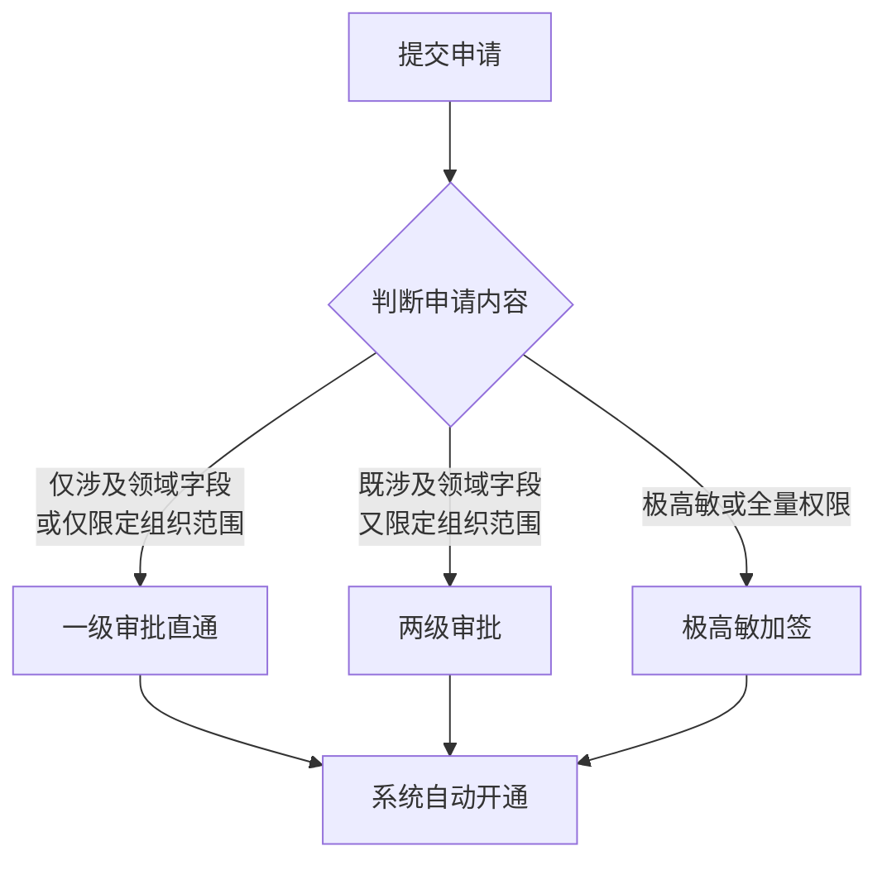

| 审批链路类型 | 审批节点 | 典型角色 |
|--------------|----------|----------|
| 一级审批直通 | 直属 + 一位负责人（领域负责人 或 组织 BPH）+ 系统开通 | OD基础/敏感/高敏、ODBP、CB系列、招聘/校招运营、SSC、生态用工、TD、OC、HRPA、通道BP、BP/BP1/BPL |
| 两级审批 | 直属 + 领域负责人 + 组织 BPH + 系统开通 | 组织 RL/R、CBBP、ERBP |
| 极高敏加签 | 直属 + 领域负责人 + 组织 BPH（如涉及）+ 人力线负责人（琳姐）终审 + 知会李小梅、HRPA + 系统开通 | BPH、OD极高敏、HR全量 |

#### 6.3.2 审批人动态确定逻辑

审批人不是固定的，而是由申请内容动态决定。系统根据以下 3 个条件确定审批人：

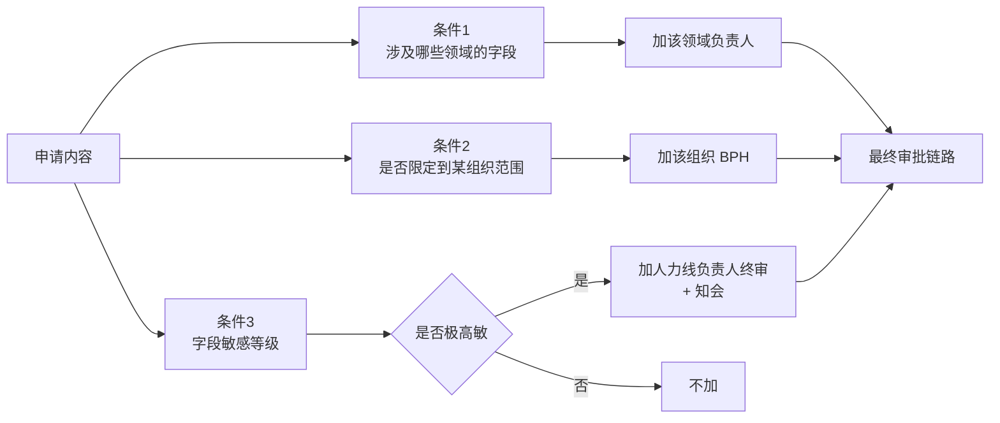

| 条件 | 加入的审批人 | 说明 |
|------|--------------|------|
| 1. 申请了哪个领域的字段 | 该领域负责人 | 根据申请中涉及的字段所属领域确定 |
| 2. 数据有没有限定到某个组织范围 | 该组织 BPH | 看申请「限定了哪些数据行」来判断，不看角色本身 |
| 3. 字段敏感等级 | 极高敏：加人力线负责人终审 + 知会李小梅、HRPA | 仅极高敏或全量权限触发加签 |

> ⚠️ 关键设计：组织 BPH 是看这条申请「限定了哪些数据行」来判断的，不看角色本身。也就是说，即使申请的是同一个角色，如果限定的组织范围不同，审批人也会不同。

#### 6.3.3 BPM 跳转与 KIM 通知

| 项 | 说明 |
|----|------|
| 实际审批位置 | BPM 流程中心（https://bpm.corp.kuaishou.com/new-bpm/v3/processes/todo） |
| 权限中心职责 | 仅展示申请详情，不执行审批操作 |
| 跳转入口 | 「我的审批」详情抽屉的「去审批」按钮，跳转 BPM |
| KIM 通知 | 审批节点变更时通知下一审批人；审批结果通知申请人 |

### 6.4 我的申请

**列表展示**：

| 字段 | 说明 |
|------|------|
| 申请单号 | BPM 流程 ID |
| 授权方式 | 按角色授权 / 按表授权 / 复制权限 |
| 角色名称 | 按表申请时显示「-」 |
| 表名称 | 展示所有涉及的表（chip 形式） |
| 申请时间 | 提交日期 |
| 申请状态 | 审批中 / 已通过 / 已驳回 / 已撤销 |
| 操作 | 查看（打开详情抽屉）、撤销（仅审批中状态） |

**筛选区**：申请单号、授权方式、角色名称、申请状态

**详情抽屉**：见 6.7

### 6.5 我的权限

**列表展示**：

| 字段 | 说明 |
|------|------|
| 权限来源 | 主动申请 / 用户组继承 |
| 角色名称 | 自定义权限显示「-」 |
| 表名称 | 展示所有涉及的表 |
| 有效期 | 截止日期 |
| 权限状态 | 生效中 / 已失效 / 主动归还 |
| 失效原因 | 权限过期 / 主动归还 / 离职失效 等 |
| 操作 | 续签（生效中）、归还（生效中）、重新申请（已失效/已归还） |

**筛选区**：权限来源、角色名称、表名称、权限状态

**详情抽屉**：见 6.7

### 6.6 我的审批

**列表展示**：

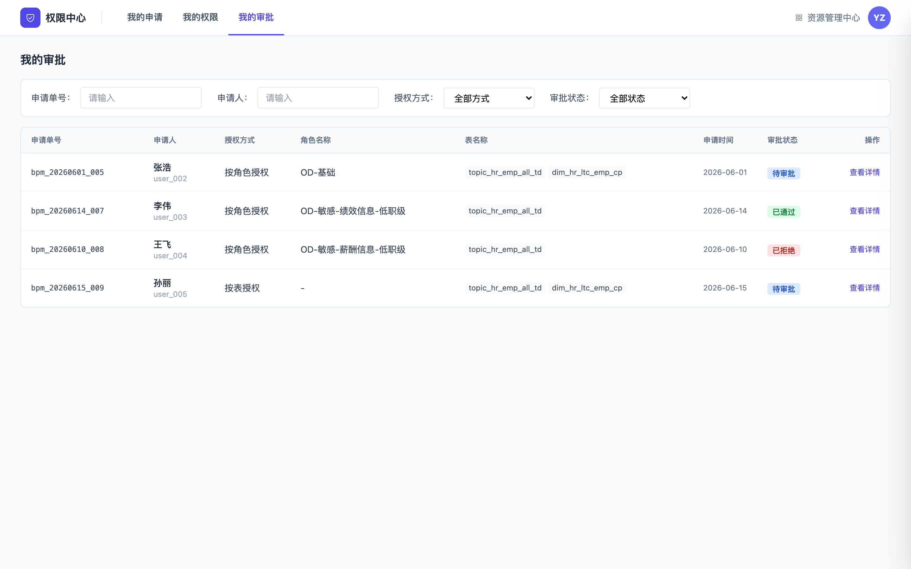

| 字段 | 说明 |
|------|------|
| 申请单号 | BPM 流程 ID |
| 申请人 | 姓名 + 工号 |
| 授权方式 | 按角色授权 / 按表授权 / 复制权限 |
| 角色名称 | 按表申请时显示「-」 |
| 表名称 | 展示所有涉及的表 |
| 申请时间 | 提交日期 |
| 审批状态 | 待审批 / 已通过 / 已拒绝 |
| 操作 | 查看详情（打开详情抽屉） |

**筛选区**：申请单号、申请人、授权方式、审批状态

**详情抽屉**：

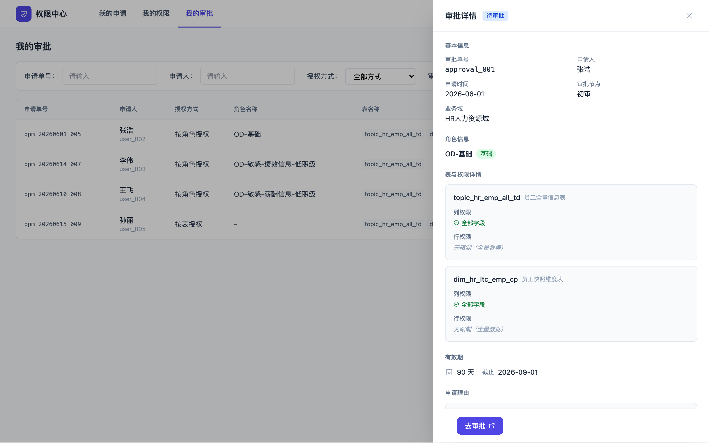

操作按钮为「去审批」（跳转 BPM）

### 6.7 申请详情抽屉

抽屉宽度 560px，从右侧滑入，包含以下区块：

| 区块 | 内容 |
|------|------|
| 基本信息 | 申请单号、申请人、申请时间、通过时间、权限来源、业务域 |
| 角色信息 | 角色名称、敏感等级标签、角色类型说明（自定义/复制自） |
| 表与权限详情 | 每张表：表名、中文名、列权限（字段列表，全部字段时显示「全部字段」）、行权限（条件列表，无限制时显示「无限制」） |
| 有效期 | 有效天数、截止日期、剩余天数（生效中权限） |
| 申请理由 | 申请人填写的理由文本 |
| 审批流程 | 节点链路（初审 → 汇报线上级 → OD负责人 → 高敏审批人 → 系统开通 → 终审），每节点显示状态（已完成/进行中/待审批）、审批人、完成时间 |

**按来源 Tab 显示不同操作按钮**：

| 来源 Tab | 操作按钮 |
|----------|----------|
| 我的申请 | 撤销申请（仅审批中状态） |
| 我的权限 | 续签权限（生效中）、归还权限（生效中）、重新申请（已失效/已归还） |
| 我的审批 | 去审批（跳转 BPM） |

### 6.8 生命周期管理

| 功能 | 说明 |
|------|------|
| 到期提醒 | 权限到期前 7天、3天、当天各发一条 KIM 消息，含权限名称、到期时间、续签链接 |
| 到期自动失效 | 未在到期前完成续签审批的权限，到期后自动失效（状态变为 expired） |
| 离职自动回收 | coreHR 在员工离职时推送消息到权限中心，自动将该员工所有生效权限立即失效 |
| 续签 | 字段范围和行规则只读不可修改，仅更新有效期，触发审批流。**审批流方案待定**（是否简化审批流程待业务确认，见待确认问题 1） |
| 归还 | 二次确认弹窗，确认后立即失效 |
| 重新申请 | 预填原申请信息（可编辑），重新提交触发审批流 |

---

## 七、配套管理端改动

### 7.1 列权限规则新增「敏感等级」字段

**改动位置**：<kfile name="PermissionRuleEditModal.html" path="js/templates/PermissionRuleEditModal.html">js/templates/PermissionRuleEditModal.html</kfile>（列权限规则新建/编辑弹窗）

**当前字段**：

| 字段 | 类型 | 说明 |
|------|------|------|
| 规则名称 | 文本 | 必填 |
| 授权对象 | 用户/人群组/部门 | 必填 |
| 规则来源 | 表专属规则 / 引用全局规则 | 必填 |
| 字段范围 | 全部字段 / 授权字段 / 排除字段 | 必填 |
| 条件配置 | 字段+运算符+值类型+值 | 可选 |
| 条件间组合关系 | 文本（如 1 AND 2 OR 3） | 可选 |
| 授权有效期 | 长期/30天/90天/180天/自定义 | 必填 |

**新增字段**：

| 字段 | 类型 | 说明 |
|------|------|------|
| 敏感等级 | 单选（基础/敏感/高敏/极高敏） | **必填**，决定该角色的审批链路 |

**敏感等级与审批链路对应关系**：

| 等级 | 说明 | 对应审批链路 |
|------|------|--------------|
| 基础 | 一般工作所需的基础字段 | 直属 + 一位负责人（领域负责人或组织BPH）+ 系统开通 |
| 敏感 | 包含绩效、职级等较敏感字段 | 直属 + 领域负责人 + 组织 BPH（如涉及）+ 系统开通 |
| 高敏 | 包含更高级别敏感信息 | 在「敏感」基础上增加审批节点 |
| 极高敏 | 最高级别，涉及顶级敏感数据 | 完整多节点审批链路 + 人力线负责人终审 + 知会 |

> ⚠️ 字段级「数据敏感等级」**本期不新增**，仅角色（列权限规则）级新增敏感等级字段。

---

## 八、审批流详述

### 8.1 三类审批链路

详见 6.3.1。

### 8.2 审批人动态确定逻辑

详见 6.3.2。

### 8.3 典型角色对应表

| 典型角色 | 审批链路类型 | 涉及领域 | 限定组织范围 | 敏感等级 |
|----------|--------------|----------|--------------|----------|
| OD基础/敏感/高敏 | 一级审批直通 | OD | 是/否 | 基础/敏感/高敏 |
| ODBP | 一级审批直通 | OD | 是 | 敏感 |
| CB系列 | 一级审批直通 | CB | 否 | 基础 |
| 组织 RL/R | 两级审批 | 组织 | 是 | 敏感 |
| CBBP | 两级审批 | CB | 是 | 敏感 |
| ERBP | 两级审批 | ER | 是 | 敏感 |
| BPH | 极高敏加签 | BPH | 是 | 极高敏 |
| OD极高敏 | 极高敏加签 | OD | 是 | 极高敏 |
| HR全量 | 极高敏加签 | HR | 是 | 极高敏 |

---

## 九、待确认问题

| # | 问题 | 影响模块 | 状态 |
|---|------|----------|------|
| 1 | 续签的审批流方案（是否简化审批流程？同样的权限续签风险较低，是否减少审批节点） | 故事6·续签 | ⏸ 待业务确认 |
| 2 | 重复发起申请时「追加权限」/「覆盖已有权限」的标注规则与冲突处理逻辑 | 故事1/2/3·申请 | 🔄 已确认允许重复发起，标注规则待细化 |
| 3 | 转岗场景的权限交接方案 | 权限交接 | ⏸ 待业务明确 |

---

## 十、暂不实现的内容（本期范围外）

- 用户组（申请加入用户组）
- 转岗权限交接（待业务明确后另起 PRD）
- 审批节点的动态审批人配置界面（依赖 BPM 侧配置，本系统不做配置页面）
- 权限续签简化流程（待问题 1 确认后决定）
- 字段级「数据敏感等级」维护（按用户指示本期忽略）
- 权限审计清查（按人查/按表查/冻结/解冻）（本期不做，直接忽略）
- 管理员设置（添加/停用/移除权限管理员）（本期不做，直接忽略）

---

## 附录：参考文档

- 审批流现状文档：[权限中心需求澄清&审批流](https://docs.corp.kuaishou.com/d/home/fcAAipF-_0ZrZ0m43eZpVnuOk)
- PRD 格式参考 1：[资源管理中心 PRD](https://docs.corp.kuaishou.com/d/home/fcABDqEioR-pXgfSI3BQgnLL_)
- PRD 格式参考 2：[资源中心权限配置改造&体验优化 PRD](https://docs.corp.kuaishou.com/d/home/fcADoYcqrrcb_qcPOc_Pb_qUd)
- 历史需求文档：`权限中心需求文档_v0.1.md`（项目根目录，仅作历史参考）
